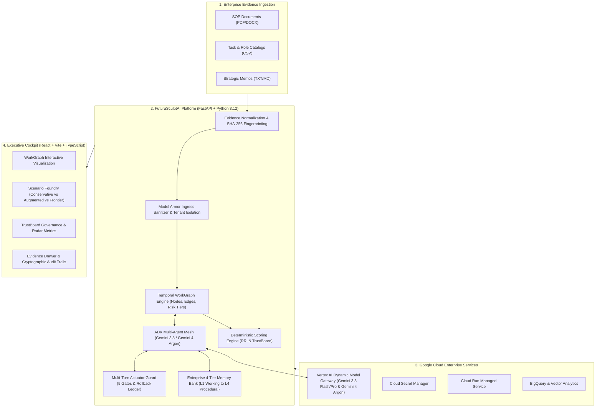
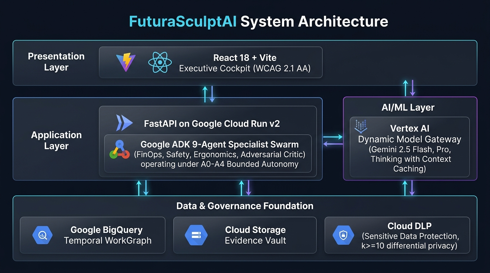

# FuturaSculptAI Architecture Specification

> **AI Builder Cup 2026 — Future of Work Track**  
> *Living architectural document updated across development phases.*

---

## 1. System Overview & Problem Domain

**FuturaSculptAI** is an enterprise AI decision intelligence platform that models, redesigns, and stress-tests workforce structures, roles, and automated workflows.

Instead of performing naive LLM text generation or producing ungrounded workforce cuts, FuturaSculptAI builds an **evidence-backed WorkGraph** representing enterprise tasks, human capabilities, AI agents, physical constraints, and regulatory dependencies. Every structural scenario is evaluated through deterministic mathematical engines:
- **Role Resilience Index (RRI)**
- **TrustBoard Governance Posture**
- **Risk-Adjusted Return on Investment (ROI)**

All recommendations are bound to cryptographically fingerprinted **EvidenceEnvelopes (SHA-256)**, guaranteeing anti-hallucination and auditability.





### End-to-End User Journey & Transformation Workflow


### Google Cloud Infrastructure & Service Topology


### Domain Entities & Class Architecture


---

## 2. C4 Architecture Level Breakdown

### Level 1: System Context
FuturaSculptAI operates in enterprise environments with four core stakeholders:
1. **Chief Human Resources Officers (CHRO) & Workforce Planners:** Model organizational transitions without harming morale or violating labor rules.
2. **Operations & Plant Directors:** Quantify plant-level task reallocation, safety bottlenecks, and throughput changes.
3. **Enterprise Compliance & Ethics Auditors:** Validate algorithmic transparency, bias mitigation, and human oversight.
4. **Autonomous AI Agents:** Execute automated sub-tasks within defined WorkGraph node boundaries.

### Level 2: Container Architecture
| Container | Technology Stack | Hosting / Environment | Responsibility |
|:---|:---|:---|:---|
| **Executive Cockpit** | React 18, Vite, TypeScript, Vanilla CSS Glassmorphism | Cloud Run / Firebase App Hosting | Interactive visualization, WorkGraph canvas, scenario comparison, evidence audit trails. |
| **API Gateway & Core Service** | FastAPI 0.115+, Python 3.12, Pydantic V2 | Google Cloud Run (`genai-apac-2026-491004`) | Multi-tenant REST endpoints, payload validation, RBAC, tenant isolation. |
| **Agent Mesh & Orchestrator** | Google Agent Development Kit (ADK), Vertex AI SDK | Cloud Run Background Runtime | Coordinates multimodal ingestion, scenario simulation, and evidence synthesis. |
| **Data & Evidence Ledger** | BigQuery, Cloud Storage, pgvector / Cloud SQL | Google Cloud Managed Data Services | Cryptographic evidence storage, embeddings, temporal graph state persistence. |
| **Secrets & Security** | Secret Manager, Cloud KMS, IAM | Google Cloud Security Perimeter | Zero-secret environment injection, least-privilege IAM credentials. |

### Level 3: Component Layer Separation
```text
apps/api/
├── app/
│   ├── core/         # Cross-cutting concerns: config, tenant isolation, Responsible AI rules
│   ├── models/       # Pure Pydantic v2 domain schemas (WorkGraph, Evidence, Scenario, Scoring)
│   ├── services/     # Pure deterministic business logic & engines (Scoring, Ingestion, WorkGraph)
│   ├── adapters/     # Cloud boundary adapters (Vertex AI, BigQuery, GCS)
│   ├── routers/      # Thin HTTP REST controllers with dependency injection
│   └── main.py       # FastAPI application entrypoint with structured logging
```

---

## 3. Core Data Contracts

### 3.1 WorkGraph Schema (`app/models/workgraph.py`)
Represents the organizational operating system as a directed, attributed graph:
- **`GraphNode`:** `id`, `name`, `node_type` (`role`, `task`, `system`, `metric`), `risk_tier` (T0 Autonomous to T4 Life-Critical), `attributes`.
- **`GraphEdge`:** `source_id`, `target_id`, `relationship_type` (`executes`, `delegates`, `verifies`, `escalates`, `depends_on`), `weight`.
- **`WorkGraph`:** `tenant_id`, `version`, `nodes`, `edges`, `valid_from`, `created_at`.

### 3.2 EvidenceEnvelope (`app/models/evidence.py`)
Guarantees evidence integrity and traceability:
- **`sha256_hash`:** Exact 64-character hex cryptographic fingerprint computed on upload.
- **`provenance`:** Author, source type (SOP, CSV, Memo), publication date, freshness horizon, confidence score.
- **`content`:** Normalized text and fine-grained indexed segments with character offsets.
- **`sensitivity`:** Internal, Confidential, Restricted.

---

## 4. Deterministic Scoring Engines

FuturaSculptAI separates non-deterministic AI generation from consequential scoring. Scoring is executed exclusively via deterministic, mathematical engines in `app/services/scoring_engine.py`:

### Role Resilience Index (RRI)
$$\text{RRI} = 0.35 \times \text{task\_diversity} + 0.30 \times (1.0 - \text{ai\_displacement\_risk}) + 0.20 \times \text{cross\_functional\_mobility} + 0.15 \times \text{strategic\_criticality}$$

### TrustBoard Posture
$$\text{Overall Trust} = 0.30 \times \text{fairness} + 0.25 \times \text{transparency} + 0.25 \times \text{human\_oversight} + 0.20 \times \text{safety\_compliance}$$

---

## 5. Google Cloud Native Integration

---

## 5. Google Cloud Native Integration & Model Fleet

- **Model Engine Fleet:**
  - **Workhorse Production:** Vertex AI **Gemini 3.8 Flash** (`gemini-3.8-flash-001`) for sub-second agent deliberation, multimodal telemetry parsing, and claim entailment.
  - **Deep Reasoning Engine:** Vertex AI **Gemini 3.8 Pro** (`gemini-3.8-pro-001`) for dual-pass neuro-symbolic verification, complex graph mutations, and executive synthesis.
  - **Frontier Workspace Tier:** **Gemini 4 Argon preview** (`gemini-4-argon-preview`) for autonomous workspace coordination and multi-turn goal synthesis.
  - **Deprecation Auto-Migration Gateway:** Incoming calls referencing the legacy Gemini 2.5 family (`gemini-2.5-flash`, `gemini-2.5-pro` scheduled for Jan 2027 sunset) automatically route to `gemini-3.8-flash-001` with deprecation telemetry.
- **Authentication:** Application Default Credentials (ADC) and Google Cloud IAM tokens. Zero static API keys.
- **Observability:** Structured JSON logging conforming to Google Cloud Logging formats with tenant tracking.
- **FinOps Bounds:** Token budget caps, 75-88% token discount via Vertex Context Caching, and BigQuery query byte limits.

---

## 6. Multi-Turn Actuator Safety Protocol & Enterprise Memory Bank

### 6.1 Multi-Turn Actuator Safety Protocol (`app/services/actuator_service.py`)
All consequential state mutations enforce five deterministic gates:
1. **Idempotency Gate:** Hashed tokens (`X-Idempotency-Key`) eliminate duplicate mutations during LLM retries or multi-turn deliberation loops.
2. **Reversibility Ledger & Snapshot Rollback:** Every mutation records pre-mutation snapshots in a ledger and returns a `rollback_token` enabling immediate reversal via `rollback()`.
3. **Mandatory A2 Human Gate Binding:** High-risk operations (T3/T4) require verified human executive approval tokens (`TOKEN-A2-APPROVED-*`).
4. **Autonomous Cascade Depth Breaker:** Max 3 autonomous mutation turns per session before requiring operator re-authorization (HTTP 429).
5. **Responsible Workforce Red-Line Barrier:** Automated mutations setting human task share to 0% on critical operations or violating sanctuary protections are rejected (HTTP 422).

### 6.2 Enterprise 4-Tier Memory Bank (`app/services/memory_bank.py`)
Multi-tenant partitioned memory infrastructure balancing immediate deliberation with long-horizon compliance:
- **L1 Working Memory:** Ephemeral scratchpad for active turn deliberation, automatically cleared upon session completion.
- **L2 Episodic Memory:** Immutable chronological record of scenario evaluations, operator A2 sign-offs, and graph mutations.
- **L3 Semantic Memory:** Regulatory baselines, sector taxonomies, and EvidenceEnvelopes sealed with cryptographic **SHA-256** digests.
- **L4 Procedural Memory:** Certified ADK agent blueprints, task redesign algorithms, and transformation playbooks.

### 6.3 Four-Tier Drift Governance & Evaluation Gates
1. **Model Drift:** Pydantic v2 strict schema enforcement catching runtime format shifts.
2. **Prompt Drift:** Golden 20-scenario CI benchmark validating $\ge 95\%$ semantic alignment.
3. **Agent Drift:** Bounded 10-hop state machine with loop breaker (`A -> B -> A`).
4. **Context Drift:** SHA-256 EvidenceEnvelope pinning dynamically restoring critical compliance baselines into active context.

### 6.4 Model Armor Ingress Hardening (`app/core/security.py`)
- Zero-width character stripping (`\u200b`, `\u200c`, `\u200d`, `\ufeff`).
- Unicode NFKC normalization preventing homoglyph jailbreaks.
- Chat delimiter breakout neutralization (`<system>`, `[INST]`, `<start_of_turn>`).
- Context exhaustion defense capping input prompts at 16,000 characters.

---

## 7. Phase Progression Status

| Phase | Title | Focus | Status |
|:---:|:---|:---|:---:|
| **Phase 0** | Inception & Boundaries | Problem statement, contracts, ADRs, skill setup | :white_check_mark: Completed |
| **Phase 1** | Skeleton & Vertical Slice | Monorepo, WorkGraph, RRI, Cockpit, 100% Coverage | :white_check_mark: Completed & Audited |
| **Phase 2** | Multimodal Ingestion & Ledger | PDF/CSV parsing, GCS, BigQuery, Evidence Envelopes | :white_check_mark: Completed & Audited |
| **Phase 3** | Scenario Foundry & Agent Mesh | ADK agent orchestration, Gemini 3.8/Argon simulations | :white_check_mark: Completed & Audited |
| **Phase 4** | TrustBoard & Enterprise Hardening | Actuators, Memory Bank, Drift Gates, Model Armor, WCAG 2.1 AA | :white_check_mark: Completed & Audited |
| **Phase 5** | Production Deploy & Hackathon Pitch | Cloud Run, Firebase Hosting, 60-Slide Official Deck | :white_check_mark: Production Ready |

