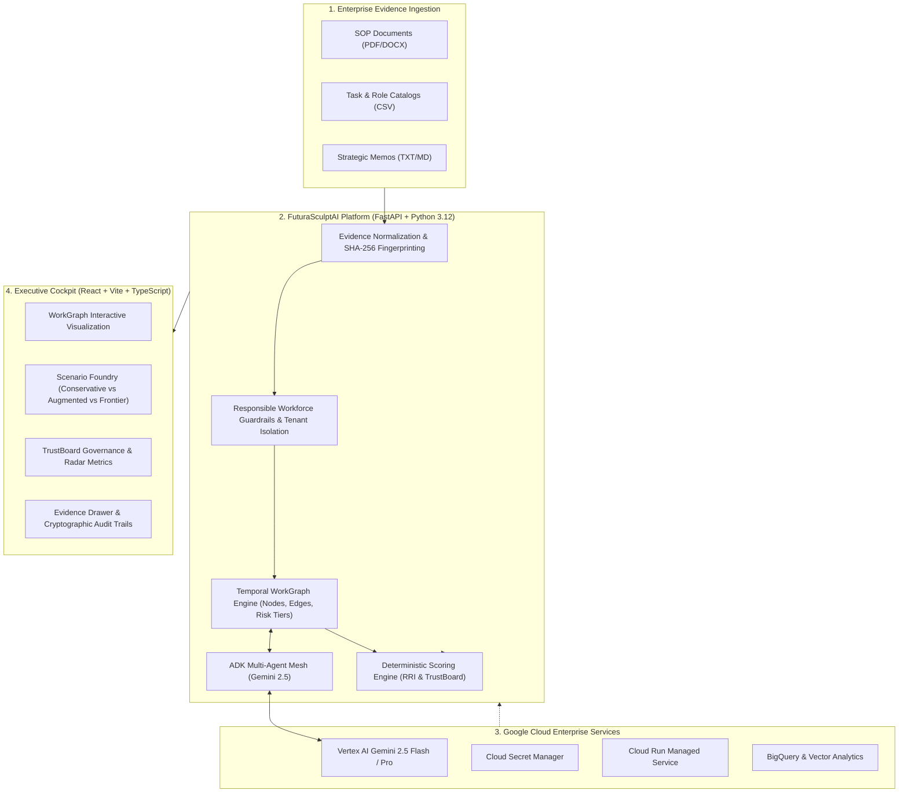

# FuturaSculptAI Architecture Specification

> **AI Builder Cup 2026 — Future of Work Track**  
> *Living architectural document updated across development phases.*

---

## 1. System Overview & Problem Domain

**FuturaSculptAI** is an enterprise AI decision intelligence platform that models, redesigns, and stress-tests workforce structures, roles, and automated workflows.

Instead of performing naive LLM text generation or producing ungrounded workforce cuts, FuturaSculptAI builds an **evidence-backed WorkGraph** representing enterprise tasks, human capabilities, AI agents, physical constraints, and regulatory dependencies. Every structural scenario is evaluated through deterministic mathematical engines:
- **Role Resilience Index (RRI)**
- **TrustBoard Governance Posture**
- **Risk-Adjusted Return on Investment (ROI)**

All recommendations are bound to cryptographically fingerprinted **EvidenceEnvelopes (SHA-256)**, guaranteeing anti-hallucination and auditability.



---

## 2. C4 Architecture Level Breakdown

### Level 1: System Context
FuturaSculptAI operates in enterprise environments with four core stakeholders:
1. **Chief Human Resources Officers (CHRO) & Workforce Planners:** Model organizational transitions without harming morale or violating labor rules.
2. **Operations & Plant Directors:** Quantify plant-level task reallocation, safety bottlenecks, and throughput changes.
3. **Enterprise Compliance & Ethics Auditors:** Validate algorithmic transparency, bias mitigation, and human oversight.
4. **Autonomous AI Agents:** Execute automated sub-tasks within defined WorkGraph node boundaries.

### Level 2: Container Architecture
| Container | Technology Stack | Hosting / Environment | Responsibility |
|:---|:---|:---|:---|
| **Executive Cockpit** | React 18, Vite, TypeScript, Vanilla CSS Glassmorphism | Cloud Run / Firebase App Hosting | Interactive visualization, WorkGraph canvas, scenario comparison, evidence audit trails. |
| **API Gateway & Core Service** | FastAPI 0.115+, Python 3.12, Pydantic V2 | Google Cloud Run (`genai-apac-2026-491004`) | Multi-tenant REST endpoints, payload validation, RBAC, tenant isolation. |
| **Agent Mesh & Orchestrator** | Google Agent Development Kit (ADK), Vertex AI SDK | Cloud Run Background Runtime | Coordinates multimodal ingestion, scenario simulation, and evidence synthesis. |
| **Data & Evidence Ledger** | BigQuery, Cloud Storage, pgvector / Cloud SQL | Google Cloud Managed Data Services | Cryptographic evidence storage, embeddings, temporal graph state persistence. |
| **Secrets & Security** | Secret Manager, Cloud KMS, IAM | Google Cloud Security Perimeter | Zero-secret environment injection, least-privilege IAM credentials. |

### Level 3: Component Layer Separation
```text
apps/api/
├── app/
│   ├── core/         # Cross-cutting concerns: config, tenant isolation, Responsible AI rules
│   ├── models/       # Pure Pydantic v2 domain schemas (WorkGraph, Evidence, Scenario, Scoring)
│   ├── services/     # Pure deterministic business logic & engines (Scoring, Ingestion, WorkGraph)
│   ├── adapters/     # Cloud boundary adapters (Vertex AI, BigQuery, GCS)
│   ├── routers/      # Thin HTTP REST controllers with dependency injection
│   └── main.py       # FastAPI application entrypoint with structured logging
```

---

## 3. Core Data Contracts

### 3.1 WorkGraph Schema (`app/models/workgraph.py`)
Represents the organizational operating system as a directed, attributed graph:
- **`GraphNode`:** `id`, `name`, `node_type` (`role`, `task`, `system`, `metric`), `risk_tier` (T0 Autonomous to T4 Life-Critical), `attributes`.
- **`GraphEdge`:** `source_id`, `target_id`, `relationship_type` (`executes`, `delegates`, `verifies`, `escalates`, `depends_on`), `weight`.
- **`WorkGraph`:** `tenant_id`, `version`, `nodes`, `edges`, `valid_from`, `created_at`.

### 3.2 EvidenceEnvelope (`app/models/evidence.py`)
Guarantees evidence integrity and traceability:
- **`sha256_hash`:** Exact 64-character hex cryptographic fingerprint computed on upload.
- **`provenance`:** Author, source type (SOP, CSV, Memo), publication date, freshness horizon, confidence score.
- **`content`:** Normalized text and fine-grained indexed segments with character offsets.
- **`sensitivity`:** Internal, Confidential, Restricted.

---

## 4. Deterministic Scoring Engines

FuturaSculptAI separates non-deterministic AI generation from consequential scoring. Scoring is executed exclusively via deterministic, mathematical engines in `app/services/scoring_engine.py`:

### Role Resilience Index (RRI)
$$\text{RRI} = 0.35 \times \text{task\_diversity} + 0.30 \times (1.0 - \text{ai\_displacement\_risk}) + 0.20 \times \text{cross\_functional\_mobility} + 0.15 \times \text{strategic\_criticality}$$

### TrustBoard Posture
$$\text{Overall Trust} = 0.30 \times \text{fairness} + 0.25 \times \text{transparency} + 0.25 \times \text{human\_oversight} + 0.20 \times \text{safety\_compliance}$$

---

## 5. Google Cloud Native Integration

- **Model Engine:** Vertex AI **Gemini 2.5 Flash** (high-throughput reasoning) and **Gemini 2.5 Pro** (deep architectural synthesis).
- **Authentication:** Application Default Credentials (ADC) and Google Cloud IAM tokens. No static API keys.
- **Observability:** Structured JSON logging conforming to Google Cloud Logging formats with tenant tracking.
- **FinOps Bounds:** Token budget caps, context caching for reference documents, and BigQuery byte limits.

---

## 6. Responsible AI & Workforce Safeguards

1. **No Individual Adverse Actions:** Platform models roles, capabilities, and macro structures—never individual employee termination recommendations.
2. **Explicit Human-in-the-Loop (HITL):** High-risk reallocations (T3/T4) require explicit human executive confirmation.
3. **Input Sanitization:** Adversarial prompt injections attempting to bypass safety policies are intercepted at ingress (`app/core/security.py`).
4. **Anti-Facade Rule:** Real Google Cloud SDKs and typed interfaces are implemented; mock string simulations are prohibited.

---

## 7. Phase Progression Status

| Phase | Title | Focus | Status |
|:---:|:---|:---|:---:|
| **Phase 0** | Inception & Boundaries | Problem statement, contracts, ADRs, skill setup | :white_check_mark: Completed |
| **Phase 1** | Skeleton & Vertical Slice | Monorepo, WorkGraph, RRI, Cockpit, 100% Coverage | :white_check_mark: Completed & Audited |
| **Phase 2** | Multimodal Ingestion & Ledger | PDF/CSV parsing, GCS, BigQuery, Evidence Envelopes | :arrow_forward: Next |
| **Phase 3** | Scenario Foundry & Agent Mesh | ADK agent orchestration, Gemini 2.5 simulations | Pending |
| **Phase 4** | TrustBoard & Enterprise Hardening | Explainability, FinOps audits, WCAG 2.1 AA | Pending |
| **Phase 5** | Production Deploy & Hackathon Pitch | Cloud Run, Terraform IaC, 4-min video demo | Pending |
