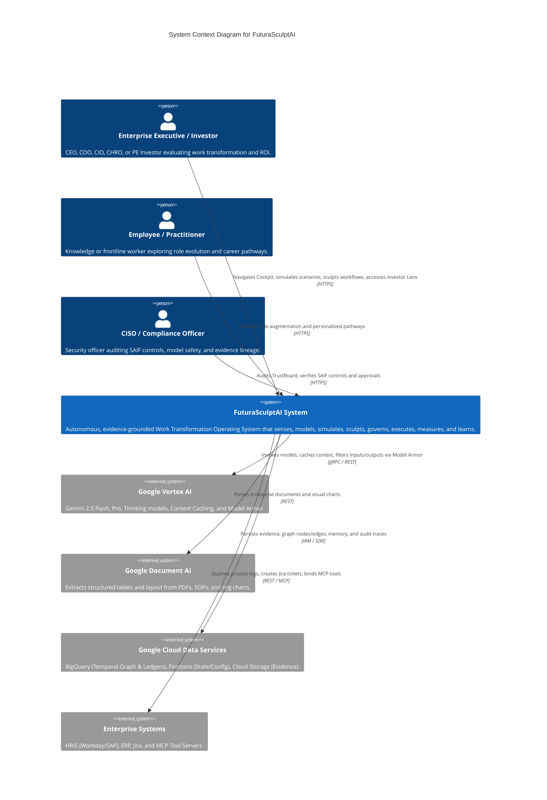

# FuturaSculptAI: C4 Architecture Specification

This document details the C4 Level 1 (System Context) and Level 2 (Container) architecture specifications for FuturaSculptAI on Google Cloud.


*Figure 1: FuturaSculptAI High-Performance Enterprise Architecture Blueprint featuring Google Cloud Pub/Sub Event Mesh, Vertex AI Gemini 3.8/Argon Dynamic Model Gateway, OpenTelemetry Monitoring, and Temporal WorkGraph Engine.*

## Level 1: System Context Diagram



---

## Level 2: Container Diagram


*Figure 2: Google ADK Autonomous Specialist Agent Mesh Topology with Cryptographic Provenance Ledgers, Least-Privilege Tools, and Gatekeeper Invariant Enforcement.*

```mermaid
C4Container
    title Container Diagram for FuturaSculptAI

    Person(user, "Enterprise User / Investor", "Cockpit operator.")

    Container(webApp, "Enterprise Web Cockpit", "React 18, Vite, TypeScript", "Responsive glassmorphic SPA delivering WorkGraph visualizer, Scenario Foundry, Task Sculptor, TrustBoard, and Investor Lens.")
    
    Container_Boundary(apiBoundary, "FuturaSculptAI Backend (Cloud Run)")
        Container(apiGateway, "FastAPI Service", "Python 3.12, FastAPI, Pydantic", "Handles REST endpoints, authentication, tenant tenancy, rate limiting, and SSE event streaming.")
        Container(orchestrator, "ADK Engagement Orchestrator", "Google ADK (Python)", "Coordinates multi-agent specialist mesh, executes control loop, manages A0-A3 approvals.")
        Container(agentMesh, "Specialist Agent Mesh", "14 Domain Specialists", "WorkGraphAgent, FutureSignalsAgent, TaskRedesignAgent, BusinessSolutionAgent, AgentBlueprintAgent, TrustGovernanceAgent, CriticAgent, etc.")
        Container(modelGateway, "Dynamic Model Gateway", "Python, Vertex SDK", "Routes requests by complexity/SLO/cost to Gemini 2.5 Flash/Pro/Thinking, manages retries and fallbacks.")
        Container(promptCompiler, "Prompt Compiler & Registry", "Python", "Assembles versioned prompts from immutable policy envelopes, recipes, and retrieved evidence.")
        Container(cacheManager, "Multi-Tier Cache Manager", "Python", "Coordinates L0 Request, L1 Semantic, L2 Retrieval, L3 Vertex Context, and L4 Artifact caching.")
        Container(memoryBroker, "Scoped Memory Broker", "Python", "Manages session working memory, episodic transformation history, and semantic enterprise memory.")
        Container(scoreEngine, "Deterministic Scoring Engine", "Python", "Calculates RRI, TRS, WAI, HOS, and Well-Architected pillar scores without LLM drift.")
    Container_Boundary_End()

    ContainerDb(bigQuery, "BigQuery Temporal Store", "BigQuery", "Stores temporal WorkGraph nodes/edges, Evidence Ledger, and Outcome Ledger.")
    ContainerDb(firestore, "Operational State Store", "Cloud Firestore", "Stores tenant configuration, user sessions, approval workflows, and prompt registries.")
    ContainerDb(gcs, "Evidence Storage", "Cloud Storage (GCS)", "Stores raw multimodal evidence files (PDFs, images, audio, video).")
    ContainerDb(secretMgr, "Secret Manager", "Google Secret Manager", "Secures partner API keys and third-party credentials.")

    Rel(user, webApp, "Interacts with cockpit", "HTTPS / WebSocket / SSE")
    Rel(webApp, apiGateway, "API calls and streaming responses", "HTTPS / SSE")
    Rel(apiGateway, orchestrator, "Dispatches transformation workflows", "Internal In-Process / Async")
    Rel(orchestrator, agentMesh, "Coordinates specialized tasks", "ADK Protocol")
    Rel(agentMesh, modelGateway, "Requests inference", "Internal")
    Rel(agentMesh, scoreEngine, "Invokes deterministic scoring algorithms", "Internal")
    Rel(modelGateway, promptCompiler, "Fetches compiled prompt manifest", "Internal")
    Rel(modelGateway, cacheManager, "Checks multi-tier cache", "Internal")
    Rel(agentMesh, memoryBroker, "Reads/writes tenant-scoped memory", "Internal")

    Rel(agentMesh, bigQuery, "Queries & writes temporal graph & ledgers", "BigQuery Storage API")
    Rel(apiGateway, firestore, "Reads/writes operational state & approvals", "Firestore SDK")
    Rel(apiGateway, gcs, "Uploads & streams evidence files", "Cloud Storage SDK")
    Rel(apiGateway, secretMgr, "Fetches secrets during cold start", "Secret Manager SDK")
```
